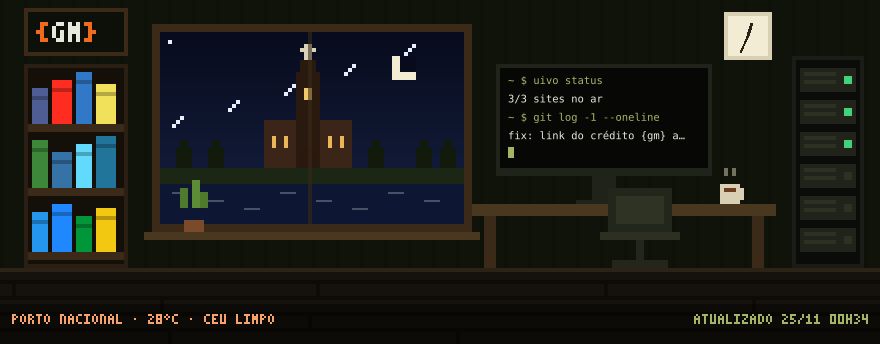
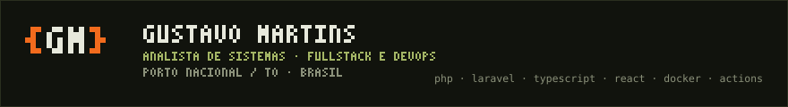
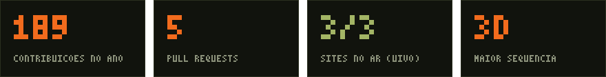
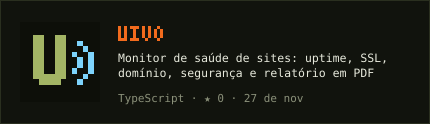
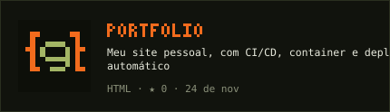
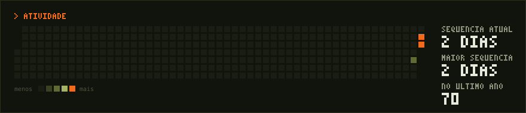

  

 

Construo sistemas web, sites e a infraestrutura que mantém tudo no ar, do banco de dados ao deploy.
Boa parte do trabalho é para clientes e fica em repositórios privados; os projetos estão descritos no [portfólio](https://gustavom.vercel.app).

### `>` projetos

<!-- PROJETOS:INICIO -->

  
  

<!-- PROJETOS:FIM -->

  <a href="https://gustavom.vercel.app"><b>Portfólio</b></a> ·
  <a href="https://www.linkedin.com/in/gustavomartinsc">LinkedIn</a> ·
  <a href="mailto:gustavo@rodokarlla.com.br">E-mail</a> ·
  sala atualizada a cada 4 h por GitHub Actions

